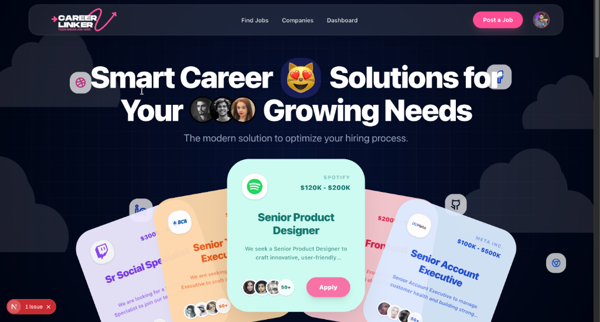
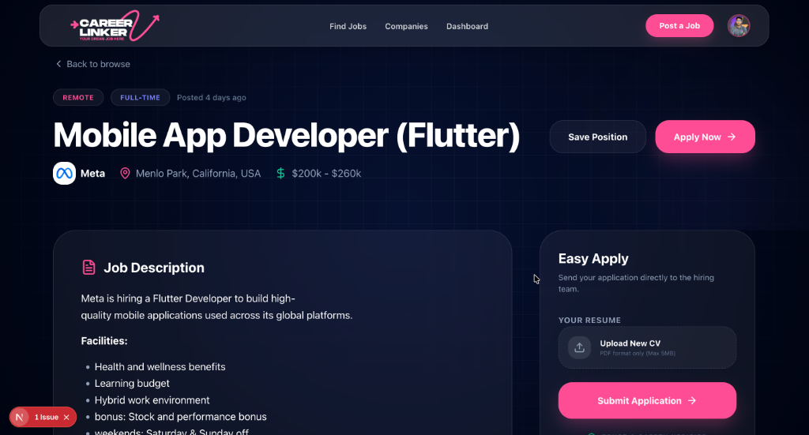
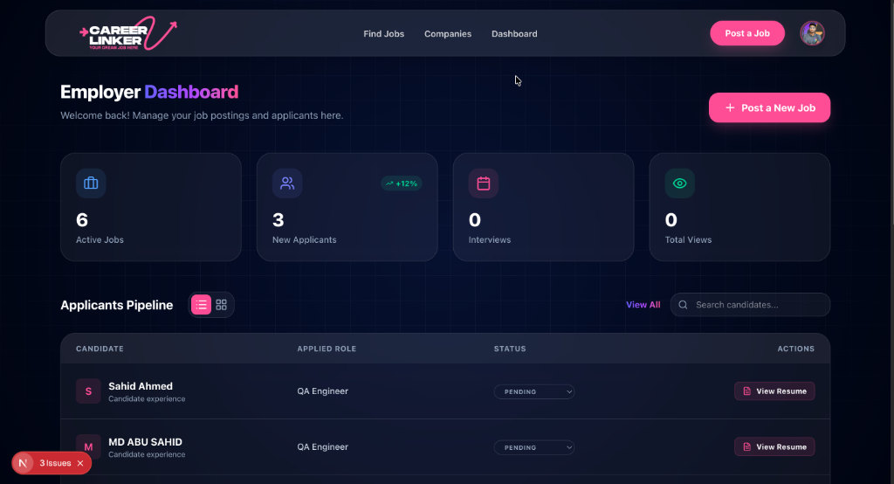

# CareerLinker 🚀
Description : A premium, high-performance job recruitment platform designed to connect ambitious talent with industry-leading employers. Built with the latest web technologies, it offers a seamless, interactive, and aesthetically stunning experience for both candidates and recruiters.

## 📸 Visual Showcase

### 🏠 Landing Page


### 📄 Job Details & Application


### 📊 Employer Dashboard


---

## ✨ Features

### 👨‍💻 For Candidates
- **Dynamic Job Discovery**: Search and filter through thousands of opportunities with real-time responsiveness.
- **Unified Auth**: Secure and seamless sign-in/up experience powered by Clerk.
- **Applicant Dashboard**: Manage your profile, track application statuses, and keep tabs on saved roles.
- **Real-time Pipeline Tracking**: Stay updated as your application moves from "Reviewing" to "Shortlisted" to "Hired".
- **Premium UX**: Liquid smooth scrolling with Lenis and interactive micro-animations powered by GSAP and Framer Motion.

### 🏢 For Employers & Recruiters
- **Intuitive Job Management**: Post and edit rich-media job descriptions using an integrated Quill editor.
- **CRM-style Applicant Pipeline**: A powerful, visual dashboard to manage candidates through the entire hiring lifecycle.
- **Interview Scheduling**: Integrated tools to organize and manage candidate interviews effortlessly.
- **Centralized Admin Dashboard**: High-level overview of active jobs, new applicants, and hiring metrics.

---

## 🛠️ Technology Stack

| Category | Technologies |
| :--- | :--- |
| **Framework** | [Next.js 16](https://nextjs.org/) (App Router), [React 19](https://react.dev/) |
| **Authentication** | [Clerk](https://clerk.com/) |
| **Backend & DB** | [Supabase](https://supabase.com/) |
| **Styling** | [TailwindCSS 4](https://tailwindcss.com/) |
| **Animations** | [Framer Motion](https://www.framer.com/motion/), [GSAP](https://greensock.com/gsap/) |
| **Smooth Scroll** | [Lenis](https://github.com/darkroomengineering/lenis) |
| **Icons & UI** | [Lucide React](https://lucide.dev/), [Sonner](https://sonner.emilkowal.ski/), [React Quill](https://github.com/gtgalone/react-quill-new) |

---

## 🚀 Getting Started

### Prerequisites
- **Node.js**: 20.x or higher
- **npm / pnpm / yarn**
- **Clerk Account**: For authentication
- **Supabase Account**: For database and real-time features

### Installation

1. **Clone the Repo**
   ```bash
   git clone https://github.com/sahidDev09/career-linker.git
   cd career-linker
   ```

2. **Install Dependencies**
   ```bash
   npm install
   ```

3. **Run Development Server**
   ```bash
   npm run dev
   ```
   Navigate to [http://localhost:3000](http://localhost:3000) to see the magic happen.

---

## 🤝 Contributing

We welcome contributions! Please follow these steps:
1. Fork the project.
2. Create your feature branch (`git checkout -b feature/AmazingFeature`).
3. Commit your changes (`git commit -m 'Add some AmazingFeature'`).
4. Push to the branch (`git push origin feature/AmazingFeature`).
5. Open a Pull Request.

---

## 📄 License

This project is licensed under the MIT License - see the [LICENSE](LICENSE) file for details.

---

### Built with ❤️ by [sahidDev09](https://github.com/sahidDev09)
